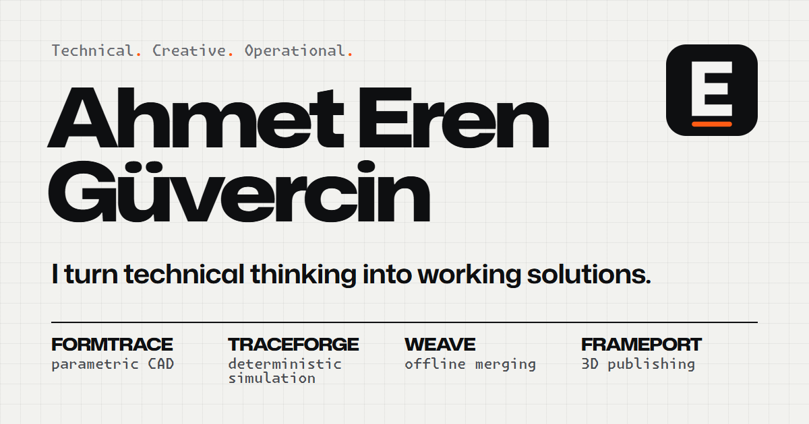
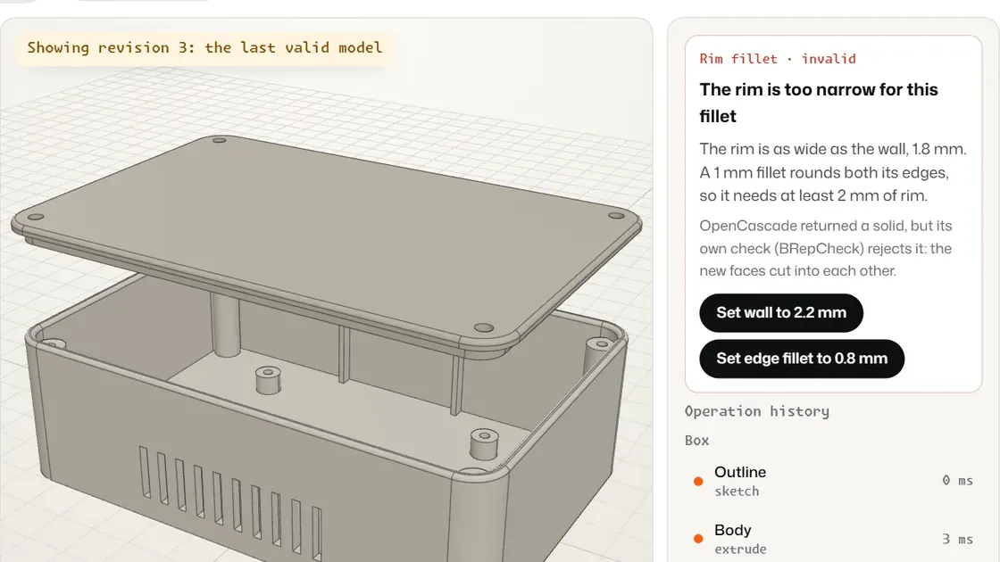
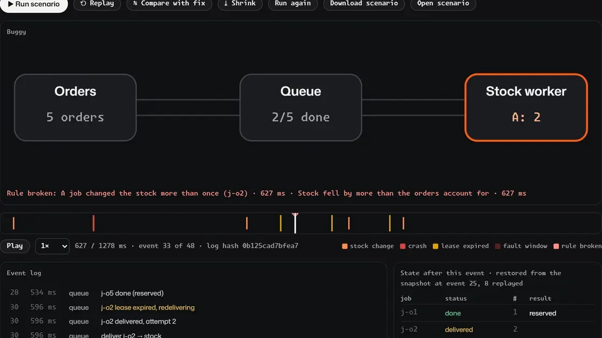
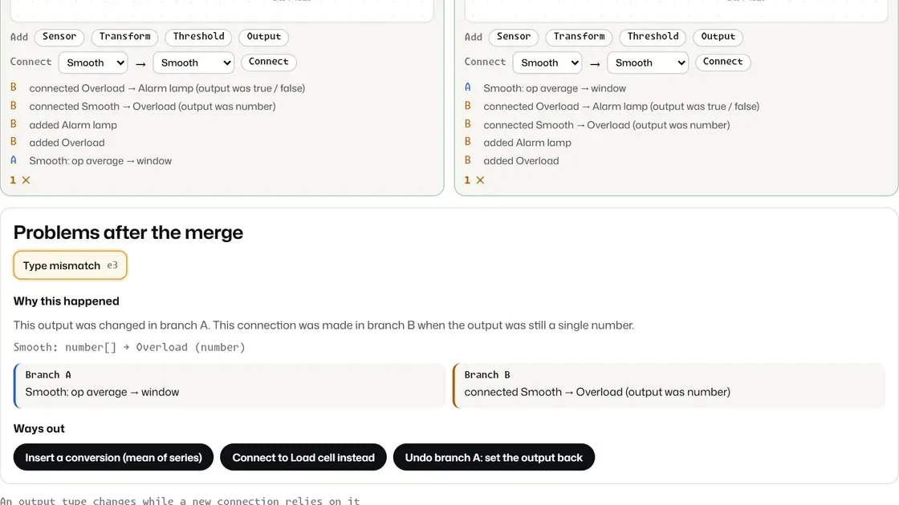
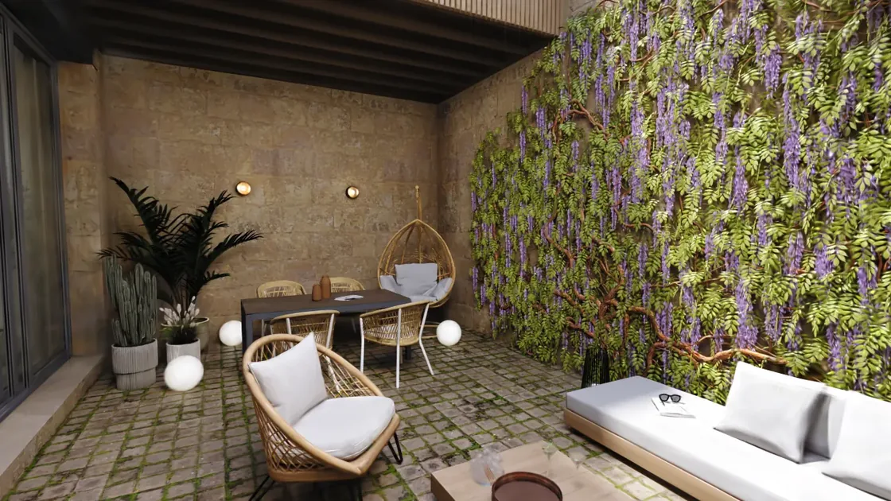
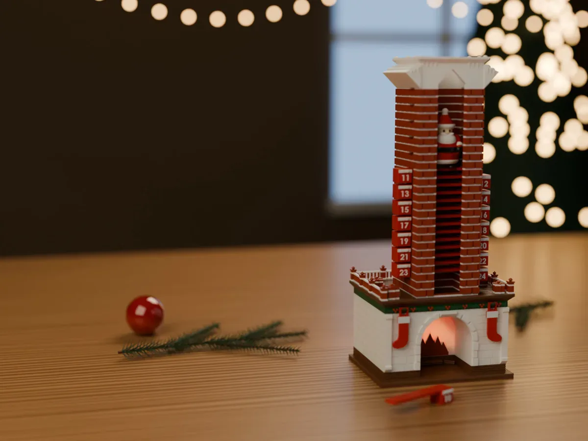
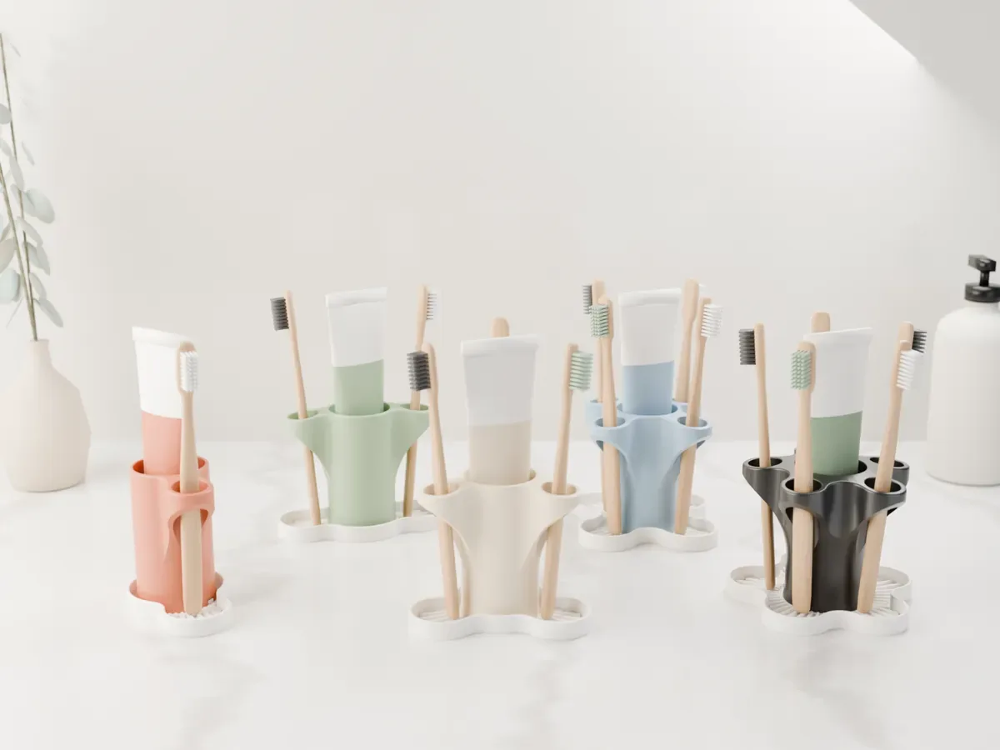

Based in Istanbul. I bring field experience, design and automation together in solutions that can be put to work: browser-based CAD and simulation prototypes, products designed for 3D printing, technical files for solar and battery-storage projects, and the day-to-day operations of my own field-service business.

🌐 **[ahmeterenguvercin.com](https://ahmeterenguvercin.com)** · [LinkedIn](https://www.linkedin.com/in/ahmeterenguvercin/) · [MakerWorld · Ribozom](https://makerworld.com/en/@Ribozom)

## 🧪 Four working prototypes

Each one starts from a real problem and states its limits. Each comes with tests, measurements and real output files, and each runs in the browser on my site.

<table>
<tr>
<td width="50%" valign="top">

<b><a href="https://ahmeterenguvercin.com/projects/formtrace/">FORMTRACE</a></b> · parametric CAD 
CAD that keeps the last valid model and explains which step failed, and why.

16-operation enclosure. Changing the rib spacing recomputes 5 of 16 operations in 165 ms. STEP and STL output reopened in FreeCAD 1.0.2. Built on OpenCascade (WebAssembly) in a Web Worker.
</td>
<td width="50%" valign="top">

<b><a href="https://ahmeterenguvercin.com/projects/traceforge/">TRACEFORGE</a></b> · deterministic simulation 
Replays a failure in a three-service system the same way every time, then proves the fix under the same faults.

Across 300 random seeds: 167 failures on the buggy version, 0 on the fix. Same seed, same event-log hash. Shrinks a failing case from 8 orders and 8 faults to 1 and 1.
</td>
</tr>
<tr>
<td width="50%" valign="top">

<b><a href="https://ahmeterenguvercin.com/projects/weave/">WEAVE</a></b> · offline collaboration 
Two people edit offline. The merge succeeds and the system breaks; WEAVE finds the two edits behind it.

300 of 300 shuffled deliveries reach the same document. 10 of 10 offered ways out resolve their problem. Automerge 3.5.0, two tabs, offline storage.
</td>
<td width="50%" valign="top">

<b><a href="https://ahmeterenguvercin.com/projects/frameport/">FRAMEPORT</a></b> · 3D publishing 
Sizes a 3D scene for the device that opens it, by measuring what each smaller version loses.

10 packages scored at 3 fixed cameras. Phone package: 3.8 MB, SSIM 0.845, first frame in 1.7 s at an emulated 20 Mbit/s.
</td>
</tr>
</table>

FORMTRACE and TRACEFORGE are the main projects; WEAVE and FRAMEPORT are narrower support projects.

## 📦 Products

<table>
<tr>
<td width="50%" valign="top">

<b>Rooftop</b> · mechanical advent calendar 
Pull a gift each day and Santa drops one 6 mm step down the chimney. The first version needed eight plates and superglue; the final one prints on two plates with no supports and no glue.

60 of 60 upright landings in a rigid-body drop test on the real meshes. Finite-element check: safety factor 2.5. Published on MakerWorld on 7 Oct 2026; 11,417 saves and a 4.9 / 5 rating from 40 ratings as of 30 Oct 2026.
</td>
<td width="50%" valign="top">

<b>Bloom</b> · product family, v2 in progress 
A toothbrush and toothpaste organiser in five footprints, from a leaf to a five-point star. Water runs off into a removable drip tray that keys in one way only.

Before a new product I measure what my printer can do: 15 surface textures, 17 fit and tolerance tests, 8 locking joints. Every new part is drawn against those numbers.
</td>
</tr>
</table>

Both are published under **Ribozom**, a brand I designed myself: name, logo, palette, listings and print guides.

## ⚡ Other work

**Energy.** Technical and commercial files for solar and battery-storage projects: feasibility and yield estimates with PVGIS, equipment lists, single-line diagrams, layouts and schedules. The range runs from rooftop feasibilities of 130 and 343 kWp to a 40 MWp ground-mount EPC proposal with single-axis trackers, plus battery-storage and transformer sourcing with manufacturers abroad, in English.

**Business and operations.** I run my own field-service business with corporate customers on monthly contracts: site visits, quotes, invoicing and collections. Quotes are priced from the scope of the job, and bank statements are matched to the invoices they close so open balances stand out.

**Video and visuals.** Editing for short and long form, corporate and product films, company profiles and proposal decks, logo and brand visuals.

**Small tools.** I look for the step that keeps repeating and build the smallest thing that removes it: a fifteen-line script that enters 300 marketplace tags in half a minute instead of 25, a renaming rule that previews every change and moves nothing until the preview is clean.

## 🛠️ Tools I work with

JavaScript and TypeScript · React Native · Supabase and PostgreSQL · Python · OpenCascade · Automerge · Web Workers and WebAssembly · FreeCAD · Blender · Bambu Studio on a Bambu Lab P1S · PVGIS · Excel

## 📍 Now

- Associate degree in electrical (2026); next step is Electrical and Electronics Engineering.
- Battery-storage and transformer projects.
- Bloom v2 and new models for MakerWorld.
- Zilerno, a learning app with a guide called Zil, in development. Details stay under wraps until launch.

🗣️ English is my daily working language, Turkish is my native language, and I am building up my German.

Most of my code lives in private repositories; the prototypes above run live on the site. · Türkçe için: <a href="https://ahmeterenguvercin.com/?lang=tr">ahmeterenguvercin.com/?lang=tr</a>
